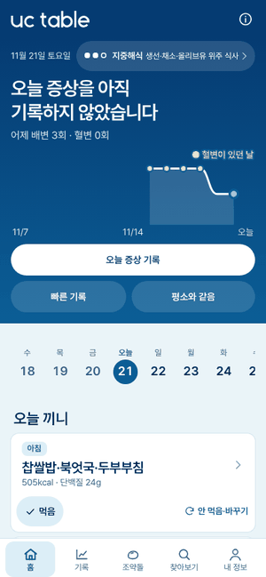
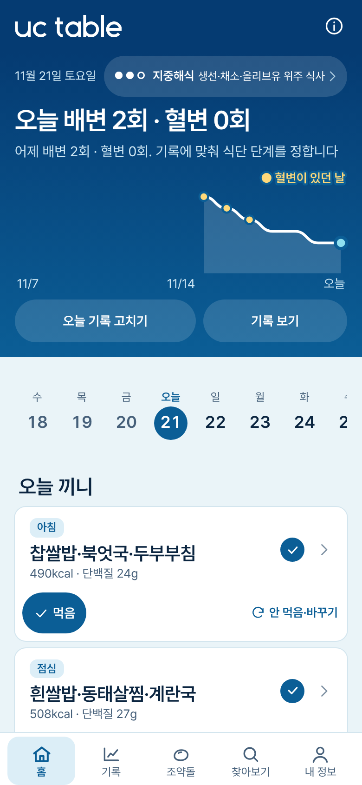
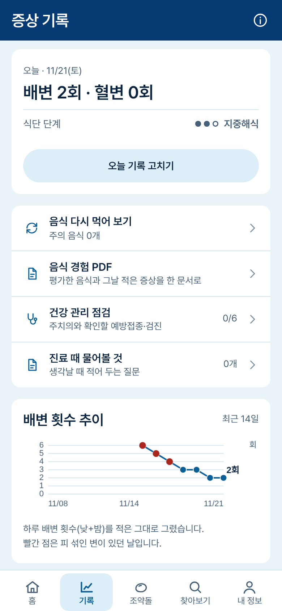
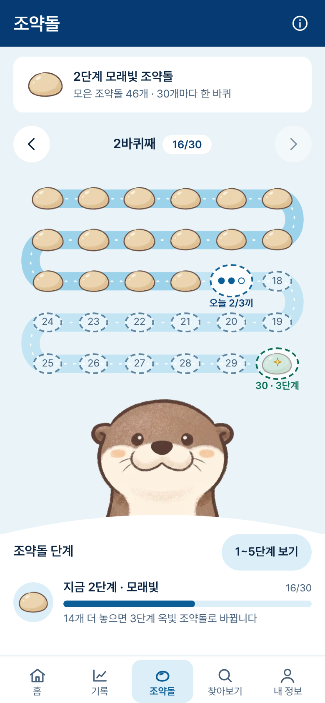
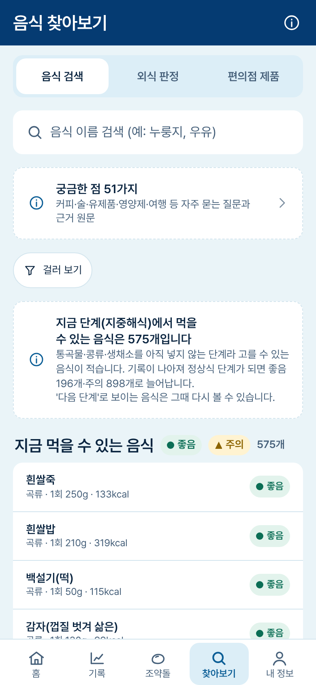
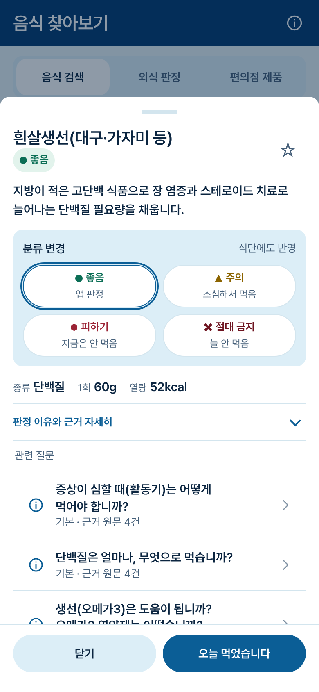
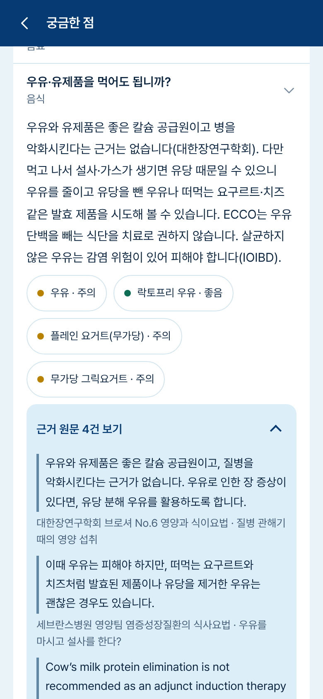
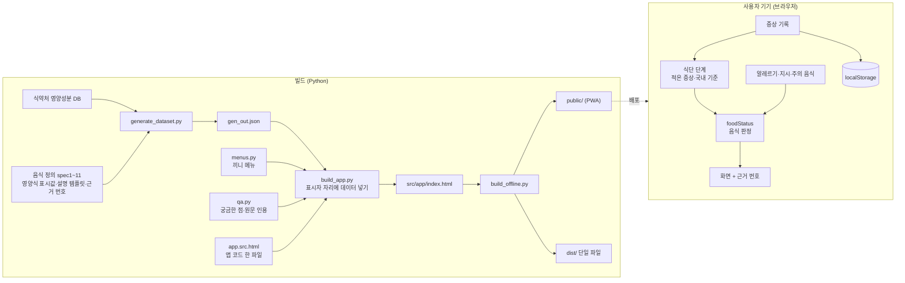

<div align="center">


# 

UC 식단 관리 도우미

**궤양성 대장염 환자가 "오늘 이거 먹어도 되나?"를 근거와 함께 바로 확인하는 모바일 웹앱**

[](https://github.com/Park11234/uc-table/actions/workflows/test.yml)


### 바로 써 보기

[**앱 열기**](https://park11234.github.io/uc-table/) &nbsp;·&nbsp; [**오프라인 파일 받기**](https://github.com/Park11234/uc-table/releases/latest/download/uc-table-offline.html)

설치 없이 브라우저에서 열리고 휴대폰에서는 '홈 화면에 추가'하면 인터넷 없이도 씁니다.
AI를 쓰지 않습니다. 판정·식단·검색·질문 답은 모두 앱 안의 자료와 규칙으로 기기에서 처리합니다.

현재 버전 v<!--n:ver-->1.13.0<!--/n-->([변경 기록](CHANGELOG.md)) · 의료기기가 아니며 진단·처방을 대신하지 않습니다([의료 관련 고지](DISCLAIMER.md)).



</div>

## 목차

- 쓰는 사람: [왜 만들었나](#왜-만들었나) · [기능](#기능) · [설치와 오프라인 사용](#설치와-오프라인-사용) · [한계](#한계) · [문의·오류 신고](#문의오류-신고)
- 만드는 사람: [실행과 개발](#실행과-개발) · [기술적으로 신경 쓴 점](#기술적으로-신경-쓴-점) · [구조](#구조) · [저장소 구조](#저장소-구조)
- 배경: [AI 기능을 뺀 이유](#ai-기능을-뺀-이유) · [만든 과정](#만든-과정) · [출처](#출처) · [English summary](#english-summary) · [라이선스](#라이선스)

## 숫자로 보는 프로젝트

| 음식 판정 | 끼니 메뉴 | 궁금한 점 | 근거 자료 | 자동 점검 | 저장 데이터 손상 퍼징 | 접근성(WCAG 2.2 AA) | 외부 요청 |
|:---:|:---:|:---:|:---:|:---:|:---:|:---:|:---:|
| <!--n:foods-->1,771<!--/n-->종 | <!--n:menus-->1,174<!--/n-->개 | <!--n:qa-->51<!--/n-->문항 · 원문 인용 <!--n:qaev-->172<!--/n-->건 | <!--n:refs-->93<!--/n-->건 | Playwright <!--n:pw-->79<!--/n-->개 + 파이썬 <!--n:pytests-->120<!--/n-->개 | 1,382가지 → 오류 0 | 위반 0 | 0건(오프라인 빌드) |

기술 스택: Vanilla JS(HTML 한 파일, 프레임워크 없음) · localStorage·IndexedDB · Service Worker(PWA) · Web Crypto(백업 암호화) · html2canvas + jsPDF · Python(음식 데이터 파이프라인) · Playwright · axe-core · ESLint · TypeScript(checkJs, 타입 검사만) · GitHub Actions / Pages

## 왜 만들었나

궤양성 대장염 환자로서 끼니마다 "이건 먹어도 되나"를 다시 찾아봐야 하는 불편을 직접 겪었습니다.
같은 음식이라도 활동기냐 관해기냐에 따라 먹어도 되는지가 달라지는데, 환자용 안내문은
"기름진 음식을 피하세요"에서 끝나는 경우가 많아 식탁 앞에서는 판단하기 어렵습니다.

그래서 이 판단을 세 단계로 자동화하고 자주 묻는 질문은 원문과 함께 앱에 넣었습니다.

1. 적은 증상(배변 횟수·피·급박감 등)을 아래 규칙에 맞춰 보고 식단 단계를 저잔사식(섬유를 줄인 식사)·지중해식(생선·채소·올리브유 위주 식사)·정상식(골고루 먹는 식사) 가운데 하나로 정합니다. 화면에는 식사 이름 옆에 먹는 내용을 윗첨자로 씁니다. 기록값은 식단 단계를 고르는 데만 쓰고 병의 상태를 판정하거나 경고하지 않습니다.
2. <!--n:foods-->1,771<!--/n-->종 음식 각각을 그 단계에 맞춰 좋음·주의·다음 단계·피하기로 나누고 아질산염(발색제)을 넣은 가공육과 내가 고른 알레르기 음식은 '절대 금지'로 둡니다. 의료진 지시·싫어하는 음식·면역을 누르는 약(날음식)도 함께 반영합니다.
3. 모든 판정 문구에 지침·논문 번호가 붙어 있어 눌러서 출처를 확인할 수 있습니다.
4. 커피·술·영양제처럼 자주 묻는 질문의 답에는 학회·병원·국제 지침의 원문 문장을 그대로 붙여 AI 없이도 찾아보고 출처를 대조할 수 있습니다.

| 홈(오늘 상태·2주 흐름) | 증상 기록 | 조약돌(수달 달이) | 음식 찾아보기 | 판정과 근거 | 궁금한 점(근거 원문) |
|---|---|---|---|---|---|
|  |  |  |  |  |  |

어두운 화면: [홈](docs/screenshots/home-dark.png) · [조약돌](docs/screenshots/pebble-dark.png) · [상세](docs/screenshots/detail-dark.png) · [궁금한 점](docs/screenshots/qa-dark.png)

## 기능

| 기능 | 하는 일 |
|---|---|
| 증상 기록 | 질문 4쪽과 요약 1쪽으로 기록. 바쁠 때는 빠른 기록(세 가지)이나 '평소와 같음' 한 번으로 저장하고 14일 배변 횟수 추이를 봄 |
| 단계 판정 | 아래 기준표에 따라 식단 단계를 자동으로 고름(직접 고정도 가능) |
| 식단 | 끼니 메뉴 <!--n:menus-->1,174<!--/n-->개에서 단계·알레르기·지시 사항에 맞는 7일 식단을 짜고 체중에 맞춰 양을 조절 |
| 음식 찾아보기 | <!--n:foods-->1,771<!--/n-->종을 이름·초성으로 찾고 지금 먹어도 되는지와 그 이유, 대신 먹을 음식을 보여 줌 |
| 궁금한 점 | <!--n:qa-->51<!--/n-->문항의 답에 학회·병원·국제 지침의 원문 문장을 붙임 |
| 외식·편의점 판정 | 메뉴 이름·재료나 포장 표시를 적으면 규칙으로 판정. 바코드는 한 번 연결해 두면 바로 찾음 |
| 홈 | 오늘 적은 값과 2주 배변 횟수 그래프, 오늘 끼니, 오늘 할 일을 한 화면에 |
| 영양·목표·보고서 | 먹은 음식과 수분을 열량·단백질 목표와 비교하고 7일·30일 보고서를 만듦 |
| 먹은 음식 추가 | 자주 먹은 음식·즐겨찾기를 먼저 보이고 무게 기준과 FODMAP 1회량을 함께 표시 |
| 장보기·알림 | 7일 식단의 장보기 목록과 휴대폰 캘린더 알림 파일(.ics) |
| 음식 다시 먹어 보기 | 주의 음식을 3일에 걸쳐 조금씩 다시 시도하며 기록 |
| 조약돌 · 수달 달이 | 하루 끼니를 다 먹은 날마다 조약돌 1개. 30개가 한 바퀴 |
| 건강 관리 점검 · 음식 경험 PDF | 예방접종·검진 확인 목록과 평가한 음식·그날 증상을 옮긴 PDF |
| 첫 실행 설정 · 기록 보호 | 첫 화면에서 앱 설명과 확인 사항을 보고 체크해 시작, 이어서 3단계 설정. 두 창에서 열 때 덮어쓰기 방지 |
| 백업·내보내기 | 백업 파일(비밀번호 암호화 선택)·CSV·PC 자동 백업 폴더 |
| 검사 수치·약 메모 | CRP 등 수치와 약을 바꾼 날을 메모로만 저장(해석하지 않음) |
| PC·아이폰 | PC는 휴대폰과 같은 화면을 가운데에, 아이폰은 입력칸 확대 방지와 공유로 저장 |

### 단계 판정 기준

최근 3일 안의 가장 최근 기록으로 판정합니다. 번호는 [근거 목록](docs/evidence.md)의 번호입니다.

| 조건 | 단계 | 근거 |
|---|---|---|
| 혈변 하루 6회 이상, 배변 하루 10회 초과, 배변 6회 이상·변 대부분 피·열, 체온 37.5℃ 이상, 복통 8점 이상, 구토 등을 적은 날 | 저잔사식 | [38], [91], [12], [40], [41] |
| 보조 합산 점수 5점 이상(옛 SCCAI 계산식, 화면에는 보이지 않음) | 저잔사식 | [11], [15] |
| 혈변 하루 4회 이상 | 저잔사식 | [12] |
| 배변 하루 5회 이상이면서 혈변 | 저잔사식 | [40] |
| 배변 하루 7회 이상 | 저잔사식 | [91] |
| 배변 하루 3회 이하(평소 횟수를 넘지 않음), 혈변·급박감 없음, 복통 4 미만, 주의 신호 없음 | 정상식 | [38], [90] |
| 그 밖 | 지중해식 | — |

- 앱은 이 조건으로 식단 단계만 고르고 화면·PDF·CSV 어디에도 점수·관해·활동기·중증도 같은 병의 상태나 경고·내원 안내를 보이지 않습니다([결정 52](docs/decisions.md)). 화면에는 적은 값(하루 배변·혈변 횟수 등)만 보입니다.
- 정상식 조건의 '평소보다 늘지 않음'은 Mayo 점수의 환자 보고 항목(PRO2) 가운데 배변 횟수 항목[91]을 따라 '평소 하루 배변 횟수'(내 정보, 비우면 1회로 보고 기록 요약에 그렇다고 적으며 첫 기록 저장 뒤 한 번 묻습니다)와 비교하고 피가 없을 것은 STRIDE-II의 증상 기준[90]을 따랐습니다. 이 계산은 단계를 고르는 데만 씁니다.
- 단계 판정에는 옛 합산 점수(SCCAI 계산식: 낮·밤 배변 횟수, 급박감, 혈변 정도, 전반적 상태, 장외 증상의 합[11])의 5점 이상 규칙을 화면에 보이지 않는 보조 규칙으로 남겼습니다. 이 점수는 재발을 민감도 92%·특이도 93%로 구분하고 환자가 직접 작성해도 의사 평가와 차이가 작다고 보고됐습니다[15]. 이 규칙을 빼면 활동기 기록 일부가 지중해식으로 내려가 단계가 덜 조심스러워지므로, 의료진 검토 전까지 남겨 둡니다.
- 기록이 3일 넘게 없어도 단계를 조용히 내리지 않고 마지막 기록의 단계를 쓰면서 홈에서 요즘 증상을 묻습니다. 2주 넘게 없으면 마지막 기록의 단계가 정상식이었어도 지중해식으로 봅니다(저잔사식까지 내리지는 않음). 단계를 직접 고정해도 표 첫 줄 조건의 기록이 있으면 저잔사식으로 바뀌고 그 밖에 기록이 저잔사식 조건에 맞으면 자동으로 바꿀지 묻습니다.
- 증상 기록이 하나도 없으면 첫 실행 때 고른 요즘 장 상태(심함·좋아지는 중·거의 없음·모름)로 시작 단계를 정합니다(모르면 저잔사식). 기록하면 기록이 우선합니다.
- 빠른 기록(세 문항)은 빠진 항목을 0으로 두고 단계를 고르며 목록·PDF·CSV·그래프에 빠른 기록이라고 표시합니다.

## 설치와 오프라인 사용

| 방법 | 쓰는 법 |
|---|---|
| [설치형 앱](https://park11234.github.io/uc-table/)(권장) | 휴대폰 크롬으로 한 번 연 뒤 메뉴 → **홈 화면에 추가**. 이후 비행기 모드에서도 열리고 앱을 고치면 다음에 열 때 새 버전으로 바뀝니다. |
| [파일 하나로](https://github.com/Park11234/uc-table/releases/latest/download/uc-table-offline.html) | 내려받은 파일을 크롬으로 열면 인터넷 없이 동작합니다(약 5 MB, 외부 요청 0건). 파일로 열 때는 서비스 워커가 동작하지 않지만 파일 자체에 모든 것이 들어 있어 필요 없습니다. |

- 기록은 연 주소(또는 파일)마다 따로 저장됩니다. 옮길 때는 **내 정보 → 데이터 백업 → 백업 파일 저장**으로 파일을 만든 뒤, 새 곳의 같은 화면에서 **백업 파일 불러오기**를 누르십시오.
- 파일 링크는 main에 올릴 때마다 `release` 워크플로가 최신 파일로 바꿔 붙입니다.
- 오프라인에서도 모든 기능이 같습니다. 끼니 메뉴 <!--n:menus-->1,174<!--/n-->개에서 그날 단계·알레르기·의료진 지시·주의 음식에 맞는 것만 골라 7일 식단을 만들고 궁금한 점 <!--n:qa-->51<!--/n-->문항과 근거 원문도 파일 안에 들어 있습니다.

## 실행과 개발

### 필요 환경

| 용도 | 필요한 것 |
|---|---|
| 앱 빌드(`build_app.py`, `build_offline.py`) | Python 3.11 이상, 표준 라이브러리만 사용(3.11·3.12에서 재현 확인) |
| 영양 데이터 재생성(`generate_dataset.py`) | pandas, 식약처 원본 CSV |
| 로고·아이콘(`tools/brand.cjs`) | Node.js와 Playwright(로고 글자를 선으로 직접 그려 글꼴 파일 없음, 앱 아이콘은 `src/brand/app-icon`의 PNG를 그대로 씀) |
| 앱 글꼴 다시 만들기(`tools/font_subset.py`) | fonttools·brotli, Pretendard 1.3.9 가변 글꼴(npm `pretendard@1.3.9`, 저장소에는 줄인 글꼴만) |
| 대표 이미지(`make_social_preview.py`) | Pillow, Noto Sans CJK 글꼴 |
| 점검 | Node.js 20 이상, `package.json`에 고정된 Playwright 1.56 · ESLint · axe-core |

### 실행

```bash
git clone https://github.com/Park11234/uc-table.git
cd uc-table
python3 -m http.server 8080 --directory public   # http://localhost:8080 (npm run serve와 같음, npm install 불필요)
```

- `dist/uc-table-offline.html`(빌드 결과)을 파일로 열면 인터넷 없이 동작합니다.
- `src/app/index.html`을 파일로 직접 열면 그림 PDF·바코드 라이브러리(`vendor/`)를 찾지 못하고 서비스 워커(오프라인 캐시)도 동작하지 않습니다. 화면을 확인할 때는 `public/`을 띄우거나 `dist/` 파일을 여십시오.

### 수정할 때

`src/app/index.html`은 빌드 결과물이므로 직접 고치지 마십시오. 다음 빌드에서 덮어써지고 CI의 재현 확인이 실패합니다.
앱 코드(화면·판정 규칙·식단)는 `src/app/app.src.html` 한 파일에서 고칩니다. 생성 데이터가 들어갈 자리는 `/*@GEN:이름@*/` 표시자로 남아 있습니다.
음식은 `src/data/spec*.py`, 영양식 제품 표시값은 `src/data/spec8.py`의 `LABEL`, 판정 문구는 `src/data/templates.py`, 끼니 메뉴는 `src/data/menus.py`, 궁금한 점은 `src/data/qa.py`에서 고친 뒤 다시 빌드합니다.
궁금한 점의 인용 대조에 쓰는 원문 파일(`data/sources/*.txt`)은 저작권 때문에 저장소에 넣지 않습니다. 파일을 만드는 법은 [근거 목록](docs/evidence.md#궁금한-점의-근거-원문-대조v170)에 있습니다.
참고문헌을 바꾸면 `python3 tools/sync_evidence.py`로 [근거 목록](docs/evidence.md) 표를 다시 만듭니다.

```bash
python3 src/data/build_app.py    # app.src.html의 표시자 자리에 데이터·메뉴를 넣어 src/app/index.html 생성
python3 tools/build_offline.py   # public/(PWA)과 dist/(단일 파일) 생성
npm ci && npx playwright install --with-deps chromium   # package-lock.json 그대로 설치
npm run lint                     # ESLint (경고 0)
npm run typecheck                # TypeScript checkJs 타입 검사 (오류 0, types/globals.d.ts)
npm run test:py                  # 데이터 생성 코드 단위 점검 <!--n:pytests-->120<!--/n-->개(파이썬 표준 라이브러리만)
npm test                         # Playwright 점검 <!--n:pw-->79<!--/n-->개(화면 비교는 node tests/visual/visual.cjs, WebKit은 tests/webkit)
npm run test:mutation            # 일부러 망가뜨린 앱 <!--n:mutants-->214<!--/n-->개를 점검이 잡는지(CI는 매주 한 번, 출시 전에는 손으로 한 번)
node tools/doc_numbers.cjs       # 문서에 적은 숫자(음식 수·문항·점검 수)가 지금 빌드와 같은지(--fix로 고침)
python3 tools/stale_check.py     # 확인한 지 1년 넘은 근거
python3 tools/link_check.py      # 참고문헌·레시피 링크 형식(--online은 실제로 열어 봄)
python3 tools/tone_check.py      # 앱 문구에 해요체(~요)가 남았는지(앱 문구는 ~입니다·~합니다)
python3 tools/stale_check.py --soon 90   # 근거 확인일 기한 90일 전 미리 알림(실패 아님)
```

식약처 원본 CSV를 `data/mfds/`에 두면 영양 데이터부터 다시 만들 수 있습니다([받는 법](docs/data-sources.md)).

## 기술적으로 신경 쓴 점

### 판정 규칙과 근거 번호

같은 입력엔 항상 같은 답이 나오도록 판정을 결정적인 코드(`foodStatus`)에 두었습니다. 판정과 안내 문장에는 참고문헌 <!--n:refs-->93<!--/n-->건(지침·논문·공식 발표·제품 자료) 가운데 어디서 왔는지 번호를 붙였습니다(ESPEN 2023, AGA 2024, IOIBD 2020, ECCO 2025, Monash FODMAP, 병원 저잔사식 안내 등). 번호로 인용하지 않고 배경으로만 둔 자료 9건은 참고문헌 목록에 '배경 자료'로 표시합니다. 원문을 읽지 못한 자료 2건은 인용하지 않고 문서에 그 사실을 남겼습니다.
궁금한 점의 답은 근거 문장을 원문 그대로 붙여 누구나 출처와 위치로 찾아 대조할 수 있게 했습니다.

### 영양 데이터

데이터는 손으로 적지 않았습니다. 기본 음식 691종의 영양값은 식약처 DB에서 이름으로 행을 찾아 붙이는 파이프라인으로 만들었습니다(영양식은 판매처 제품 표시값, 시판 과자·사탕·젤리·초콜릿·라면은 제조사 공식 자료와 식약처 가공식품 DB를 3중 대조, 마트 시판 식품은 여기에 이마트몰 포장 사진까지 대조, 원재료 49종과 밥·죽은 더 새로 고친 국가표준식품성분 DB 10.4).
원자료의 이상치(예: 멸치볶음 섬유 10.1 g)는 같은 음식의 다른 분석값과 대조해 코드로 고정했습니다.
판매처 고시·포장 표시에서 옮긴 시판 제품은 그 기록을 가져오기 스크립트(`tools/cj_import.py`·`brand_import.py`·`label_import.py`)로 앱 데이터로 바꾸고 열량 계산(4·4·9)·당류≤탄수화물·포화지방≤지방 같은 단위 점검으로 옮겨 적은 값을 확인합니다.
같은 이름의 요리 값이 여럿이면 분석값(가정식 → 외식)을 먼저 쓰고 분석값이 없으면 재료량 산출값의 평균을 씁니다(FAO/INFOODS 음식 맞추기 지침 등). 어떤 값을 골랐는지와 같은 이름 자료의 열량 범위를 음식 정보에 보여 줍니다.
앱 빌드(`build_app.py`)는 같은 입력이면 배포본과 바이트 단위로 같은 파일을 만들고 CI가 매번 확인합니다. 영양 데이터 생성(`generate_dataset.py`)은 pandas·numpy 버전에 따라 소수 끝자리가 달라질 수 있어 같은 결과를 얻으려면 버전을 맞춰야 합니다(지금 생성본은 pandas 3.0.5).

### 저장 데이터 검사

기록을 불러올 때마다 모든 항목의 형식과 범위를 확인합니다.
실제 기록을 1,373가지로 망가뜨려 모든 화면과 PDF를 그려 보는 퍼징 점검에서 처음엔 앱 멈춤 1종, 화면 오류 2종,
`NaN`·`[object Object]` 노출 여러 곳이 나왔습니다. 지금은 모두 0입니다.

### 오프라인 동작

앱 글꼴(UC Table Sans, Pretendard를 줄여 이름을 바꾼 것)과 PDF·바코드 라이브러리를 앱과 함께 넣어 외부 요청 0건으로 동작합니다(웹은 같은 주소의 파일, 오프라인 파일·APK는 파일 안에).
서비스 워커 캐시 이름을 앱 내용의 해시로 정해 앱을 고치면 설치된 기기에도 새 버전이 전달됩니다(점검으로 확인).

### 실제 사용 환경 점검

한글 IME 조합 입력, 키보드가 올라온 좁은 화면, 320 px, 큰 글자, 다크 모드,
사용자 입력의 HTML 주입, 접근성(axe-core, WCAG 2.2 AA)을 Playwright로 확인하고 ESLint 경고 0·TypeScript 타입 오류 0을 유지합니다.
모든 화면의 버튼을 2단계까지 눌러 보고 검색칸마다 이상한 검색어를 넣는 누름·검색 퍼징(누름 약 2,600회)과 주요 화면 10개를 기준 화면과 픽셀로 비교하는 화면 비교 점검도 돌립니다. 아이폰 사파리와 같은 엔진(WebKit)의 주요 흐름 점검은 CI에서 돌립니다. 디자인을 바꾼 뒤에는 agent-browser로 처음 쓰는 사람처럼 끝까지 써 보며 찾은 24건을 고쳤습니다. 이어서 그 판 전체를 다른 검토자가 다시 읽어 판정·백업·초기화·검색 등 20건을 고쳤습니다.
앱을 일부러 <!--n:mutants-->214<!--/n-->가지 방식으로 망가뜨린 뒤 해당 점검 <!--n:pairs-->219<!--/n-->쌍이 실제로 실패하는지도 매주 확인합니다. 망가뜨리는 방식에는 일반 햄이 다시 '피하기'로 바뀜, 나트륨·지방 규칙 삭제, 다른 창의 기록 덮어쓰기, 뒤로 가기가 앱 밖으로 넘어감 등이 있습니다. 전체 목록은 [점검 체계](docs/testing.md)에 있습니다.

### 기록 보관

기록은 기기 밖으로 나가지 않습니다. 서버·계정·분석 도구가 없고 저장은 기기의 localStorage(기록)와 IndexedDB(최근 7일 자동 보관본)뿐입니다. 백업 파일은 원하면 비밀번호로 암호화합니다.
같은 앱을 두 창에서 열어도 서로 덮어쓰지 않게 막고 백업을 불러올 때는 지금 기록과 비교해 합치거나 되돌릴 수 있습니다.

### 근거 관리

참고문헌마다 근거 종류와 확인 날짜를 적고 1년이 넘은 근거와 열리지 않는 링크를 매달 자동으로 점검합니다(`tools/stale_check.py`, `tools/link_check.py`).

## 구조



자세한 설명: [구조](docs/architecture.md) · [설계 결정](docs/decisions.md)

## AI 기능을 뺀 이유

예전 버전은 Claude 앱 안에서 열면 AI가 식단을 짜고 사진을 읽었지만 지금은 모두 뺐습니다.
AI 답은 매번 달라 규칙으로 다시 검사해야 했고 그 검사를 통과해도 설명 문장까지 검증할 수는 없었기 때문입니다.
대신 그 자리를 확인할 수 있는 자료로 채웠습니다.

- 끼니 메뉴 <!--n:menus-->1,174<!--/n-->개는 이미 근거를 확인한 재료와 조합 규칙(단계별 채소 수·분량, 짠 식품 상한, 같은 날 주재료 겹침 방지)으로만 만듭니다.
- 궁금한 점 <!--n:qa-->51<!--/n-->문항에는 답의 근거 문장 <!--n:qaev-->172<!--/n-->건을 원문 그대로 실었습니다. 인용이 원문 파일에 글자 그대로 있는지는 단위 점검이 확인합니다(PDF에서 공백·줄바꿈만 무시). 해외 지침 4편은 원문 페이지에서 다시 대조했습니다.
- 시판 과자·라면·마트 제품은 공식 포장 표시·식약처 DB·열량 계산이 서로 맞는 제품만 넣었습니다. 그 뒤에 더한 시판 제품 1,059종은 판매처 한 곳의 포장 표시·상품정보 고시를 그대로 옮기고 출처를 밝혔습니다(사용자 요청). 외식 프랜차이즈 메뉴는 넣지 않았습니다.

예전에 AI로 만든 식단이 기기에 남아 있으면 그대로 보여 주고 버튼 하나로 앱 규칙 식단으로 바꿀 수 있습니다.

## 만든 과정

1. 궤양성 대장염 환자로서 평소 음식을 먹을 때 불편했던 점을 바탕으로 식탁 앞에서 바로 판단할 수 있는 도구를 기획했습니다.
2. 설계·구현·검토에 AI 도구(Claude)를 활용했습니다. 문제와 제약은 직접 정했고(하루 세 끼 기준 식단, 검사 수치는 메모로만 받고 해석하지 않음, '다음'을 눌러야 넘어가는 증상 기록, 기능보다 신뢰성 우선, 앱 안에서는 AI를 쓰지 않음) 판정 규칙은 진료지침·병원 식이 안내·논문의 원문을 확인해 확정했습니다.
3. "판정을 논문과 병원 지침으로 다시 검토하라"는 요구에 따라 식약처 원자료를 대조하는 점검을 만들었고 그 과정에서 멸치볶음 섬유 10.1 g 같은 원자료 이상치 10건을 찾아 바로잡았습니다. 신뢰성 점검에서는 저장 데이터 손상 퍼징으로 앱이 멈추는 경우를 찾아 고쳤고 기존 테스트가 결과를 확인하지 않고 늘 통과하던 문제도 발견해 단언과 돌연변이 점검을 넣었습니다.
4. 주변 지인에게 앱을 소개해 비공식적으로 사용 경험을 들었고 나온 의견은 AI와 함께 반영했습니다.

더 자세한 사례와 검증 방법은 [AI와 함께 만든 방법](docs/ai-workflow.md)에 정리했습니다.

## 저장소 구조

```
index.html    저장소 첫 주소로 들어오면 앱(public/)으로 연결
src/app/      앱 코드 한 파일(app.src.html)과 빌드 결과(index.html)
src/brand/    UC TABLE 로고 SVG(tools/brand.cjs가 만듦), 앱 아이콘(app-icon, 수달 그림 E1), 조약돌 탭 그림(dari, 달이 3장·조약돌 5색 WebP), 앱 글꼴 uc-table-sans.woff2와 OFL 고지
src/data/     음식 정의(spec1~11) · 시판 제품 기록(cj10·brand10·label10) · 영양식 표시값(spec8 LABEL) · 끼니 메뉴(menus.py) · 궁금한 점(qa.py) · 설명 템플릿 · 생성·빌드 스크립트
public/       GitHub Pages로 여는 오프라인 PWA
tests/        Playwright 점검 <!--n:pw-->79<!--/n-->개 (regression <!--n:reg-->27<!--/n--> · checks <!--n:chk-->52<!--/n-->) · 화면 비교(visual) · WebKit(webkit, CI) · 파이썬 단위 점검(tests/python) · 돌연변이 점검
tools/        오프라인 빌드 · 근거 표 동기화 · 근거 확인일·링크·말투·문서 숫자 점검 · 로고·아이콘(brand.cjs) · 앱 글꼴(font_subset.py) · 스크린샷 · 린트용 추출 스크립트
docs/         구조 · 설계 결정 · 점검 · AI 활용 · 데이터 출처 · 근거 목록 · 출시 준비(release.md)
vendor/       함께 넣는 오픈소스(html2canvas, jsPDF, @zxing/library)와 라이선스(앱 '앱 정보'에도 전문)
```

## 출처

- 영양성분: 식품의약품안전처 식품영양성분DB(공공데이터포털 공개본의 이용허락범위 '제한 없음')와 농촌진흥청 국가표준식품성분 DB 10.4(원재료 49종, 밥·죽). 앱의 음식 상세 화면마다 출처·식품명·식품코드를 표시합니다.
- 시판 과자·사탕·젤리·초콜릿: 농심몰·롯데웰푸드 스위트몰·해태몰 포장 표시 이미지, 크라운제과·오리온 제품 소개, 식약처 가공식품 DB(2026-08-28)와 3중 대조(2026-09-29~30 확인).
- 판정 근거: 진료지침·병원 식이 안내·논문·공식 발표·제품 자료 <!--n:refs-->93<!--/n-->건([근거 목록](docs/evidence.md))
- 판매처 표시를 옮긴 시판 제품: CJ더마켓 상품정보 제공고시, 동원몰 상품정보 제공고시·상품 상세 포장 표시, 식품안전나라 품목제조보고, 랭킹닭컴·아임닭·풀무원샵 상품 상세 포장 표시(2026-10-14~15 확인, 제품마다 한 곳)
- 궁금한 점: 대한장연구학회 환자용 브로셔·치료 지침, 서울아산병원·서울대학교병원·세브란스병원·가천대 길병원 식이 안내, ECCO 2025·ESPEN 2023·AGA 2024·IOIBD 2020·ACG 2025 원문(2026-10-04 확인)
- 영양식 제품: 판매처 상품정보 제공고시(롯데아이몰)·다나와·제조사 제품 안내에 올라온 1팩 표시값을 100 ml당으로 바꿔 씁니다(2026-09-25 확인).
- 조리법 링크: 만개의레시피 77건, 모두의레시피 12건. 앱은 링크와 재료 요약만 담고 조리법 원문은 각 사이트에 있습니다.

자세한 내용은 [데이터 출처 문서](docs/data-sources.md)에 있습니다.

## 한계

- 의료기기가 아니며 진단·처방을 대신하지 않습니다. [의료 관련 고지](DISCLAIMER.md)를 먼저 읽어 주십시오.
- 판정은 공개 지침의 일반 권고를 옮긴 것이라 개인의 침범 범위·수술력·동반 질환을 반영하지 않습니다.
- 단계 판정표는 배변·혈변 점수, 옛 합산 점수와 국내 기준을 이 앱이 묶은 규칙이며 이 조합 자체를 검증한 연구는 없습니다.
- 영양값은 대표값이라 실제 조리법·분량에 따라 달라집니다. 스테비아 토마토·제로 음료 같은 시판 제품은 대표값이 없어 제품 1종의 값을 쓰므로 제품마다 다를 수 있습니다.
- 영양식 39종 가운데 18종은 원재료명을 판매처·제조사 공개 자료에서 글자로 확인하지 못해(표시가 이미지로만 올라와 있음) '확인하지 못한 제품'으로 두고 포장 확인을 안내합니다. 영양값은 26종에 표시값을 넣었고 나머지는 '자료 없음'으로 보입니다. 특수의료용도식품은 포장 문구대로 의료진과 상담한 뒤 쓰도록 '주의해서', 신장질환자용·경관급식 전용은 '피하기'로 둡니다.
- 스테비아·알룰로스 같은 감미료가 궤양성 대장염에 미치는 영향은 연구가 부족해, 감미료 제품은 '피하기'가 아니라 '주의해서'로 둡니다(탄산음료는 탄산 때문에 '피하기').
- 궁금한 점의 답은 자료의 안내를 옮긴 것입니다. 자료끼리 다른 곳은 두 안내를 함께 적었습니다(예: 술은 대한장연구학회가 금주를 권하고 IOIBD는 적은 양을 바꾸라고 권할 근거가 부족하다고 봅니다). 앱의 판정은 술을 절대 금지로 둡니다(요리에 넣는 맛술·미림과 술을 넣어 익힌 요리는 제외). 개인에게 맞는 결정은 주치의와 상의해야 합니다.
- 판매처 표시를 옮긴 시판 제품 1,059종(용량만 다른 같은 제품을 묶어 1,039종)은 사용자 요청에 따라 판매처 한 곳에서만 확인했습니다. 포장이 바뀌었을 수 있으니 실제 포장 표시를 함께 확인하십시오. 영양정보가 없는 가공육·육포는 원재료로만 판정하고 영양정보를 찾지 못한 만두·볶음밥·국은 넣지 않았습니다.
- 지인의 비공식 의견만 받았고 체계적인 사용성 평가나 임상 평가는 하지 않았습니다(환자 사용성 평가 방법은 [점검 문서](docs/testing.md#사용성-평가다음-단계)).
- 안드로이드 크롬 기준으로 만들었고 아이폰은 실제 기기 대신 화면 크기·입력칸 글자 크기·공유 기능과 WebKit 흐름 점검(CI)으로만 확인했습니다. iOS 사파리는 홈 화면에 추가하지 않은 사이트의 저장 데이터를 한동안 쓰지 않으면 지울 수 있으므로, iOS에서는 홈 화면에 추가하고 '백업 파일 보내기'로 자주 보관하십시오.
- 음식의 '확인 날짜'는 그 음식을 앱에 넣은 날입니다(사용자 요청, 1년 지난 것을 다시 확인하라는 점검은 하지 않음). 넣은 날 기록이 없는 예전 음식은 '2026-09-24 이전'이나 '2026-10-13 이전'으로 보입니다.
- 훈제오리 판정은 앱에 넣은 시판 훈제오리(2종, 모두 발색제)로 정했습니다. 제품이 늘면 비율이 바뀔 수 있습니다. 비비고 일품요리는 포장에 몇 인분인지 자료가 없어 '포장 1인분, 600g 넘으면 반'으로 1회 분량을 잡았습니다.
- 홈의 2주 능선 그래프는 기록한 날만 잇고 3일 넘게 빈 날이 있으면 선을 끊습니다. 그래프의 날짜별 값은 그림으로만 보이므로 날짜별 횟수는 '최근 기록' 목록에서 글자로 보십시오.
- 흔한 외식 메뉴 41종 가운데 연어덮밥·규동·가츠동·텐동·시저샐러드·햄 토스트 6종은 식약처 음식 DB에 같은 이름 자료가 없어 영양값 없이 판정만 합니다. 알레르기 태그는 식당마다 재료가 달라 흔히 들어가는 재료를 넉넉히 붙였습니다.
- 바코드는 앱 자료에 바코드 번호(GTIN)가 없어, 처음 읽은 바코드를 사용자가 직접 음식과 연결해야 합니다. 카메라 읽기는 BarcodeDetector가 없는 브라우저(아이폰 등)에서 바코드 라이브러리(@zxing/library)를 처음 쓸 때 불러옵니다(같은 주소의 파일, 오프라인 파일은 파일 안). 카메라 화면은 기기 안에서만 읽고 저장하지 않습니다.

## 문의·오류 신고

- 화면이 깨지거나 기능이 동작하지 않으면 [새 이슈](https://github.com/Park11234/uc-table/issues/new/choose)에서 '오류 신고' 양식으로 알려 주십시오. 건강 기록이 보이는 화면 사진은 가리고 백업 파일은 올리지 마십시오.
- 음식의 판정·영양값·원재료·1회 분량이 근거나 포장 표시와 다르면 같은 곳의 '잘못된 판정·영양값' 양식에 포장 사진이나 자료 주소를 함께 적어 주십시오.
- 기록이 밖으로 나가는 문제 같은 보안 문제는 공개 이슈 대신 [SECURITY.md](SECURITY.md)에 적힌 방법으로 비공개로 알려 주십시오.

## English summary

UC TABLE (UC 식단 관리 도우미, UC Diet Care Assistant) is an offline-first mobile web app that helps people with ulcerative colitis decide what they can eat today.
The app reads the symptom log (stool frequency compared with the usual count, bleeding, and Korean clinical criteria) only to choose a diet stage: low-residue, Mediterranean, or regular. It shows the logged values as entered and never states a disease activity level, a score, or a warning.

<!--n:foods-->1,771<!--/n--> foods, including <!--n:prod-->1,233<!--/n--> packaged products and 41 common restaurant dishes, are judged by fixed rules, and each judgment links to one of <!--n:refs-->93<!--/n--> cited guidelines, papers, and product sources.
Nutrition values come from the Korean MFDS food database through a reproducible pipeline, and CI checks that the app build is byte-identical.
The app is a single HTML file with no framework. Records stay on the device (localStorage plus a 7-day IndexedDB snapshot), the screens block every network connection, and backups can be encrypted with a password (PBKDF2-SHA256 with 310,000 iterations, then AES-GCM 256).
No AI runs inside the app. Meal plans come from <!--n:menus-->1,174<!--/n--> meal templates built from reviewed components, and the <!--n:qa-->51<!--/n--> Q&A entries quote <!--n:qaev-->172<!--/n--> evidence passages that a unit test checks word for word against the source texts.
A pebble tab adds one pebble for each day on which every planned meal is marked as eaten, and a per-food PDF lists each rated food with the dates eaten, the user's rating and notes, and that day's logged symptoms.

Testing: <!--n:pw-->79<!--/n--> Playwright suites and <!--n:pytests-->120<!--/n--> Python unit tests. The Playwright suites cover state-corruption fuzzing (1,373 cases, 0 failures), click and search fuzzing (about 2,600 taps), axe-core WCAG 2.2 AA (0 violations) with 44 px touch targets, Korean IME input, and PWA update delivery.
Separate scripts compare 10 main screens with reference images pixel by pixel, and CI runs the main flows in WebKit. A documentation-number check keeps the figures in this README current, and a weekly job confirms that the tests fail on <!--n:mutants-->214<!--/n--> deliberately broken builds.
The app was built with Claude; see [docs/ai-workflow.md](docs/ai-workflow.md). Release history is in [CHANGELOG.md](CHANGELOG.md).

## 라이선스

코드는 [MIT](LICENSE)입니다. 영양 데이터는 식품의약품안전처 공개 데이터를 이용했으며 출처 표시를 유지합니다.
포함된 오픈소스(Pretendard 글꼴 OFL 1.1, html2canvas·jsPDF MIT, @zxing/library Apache-2.0)의 라이선스는 [데이터 출처 문서](docs/data-sources.md)와 앱의 '앱 정보'에 있습니다.
