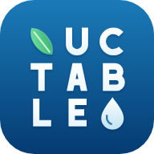
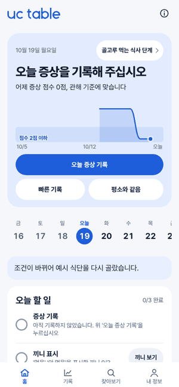
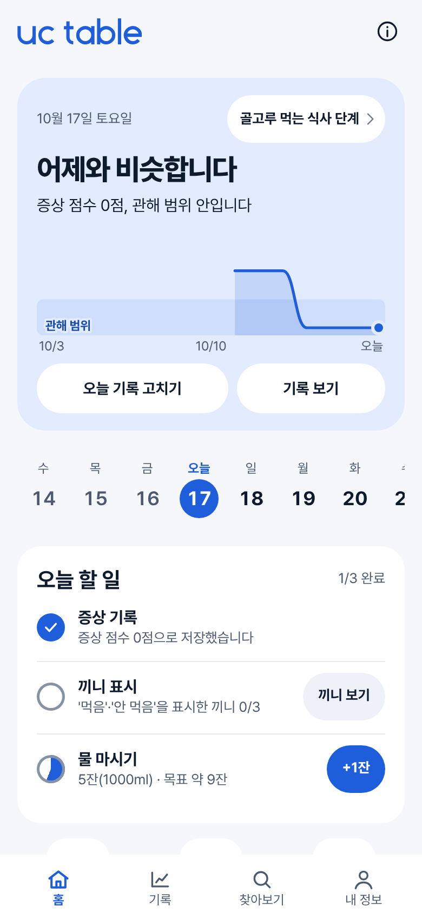
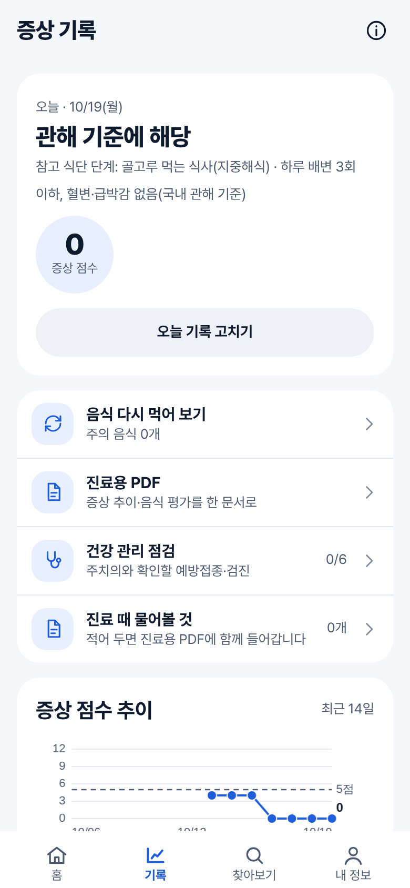
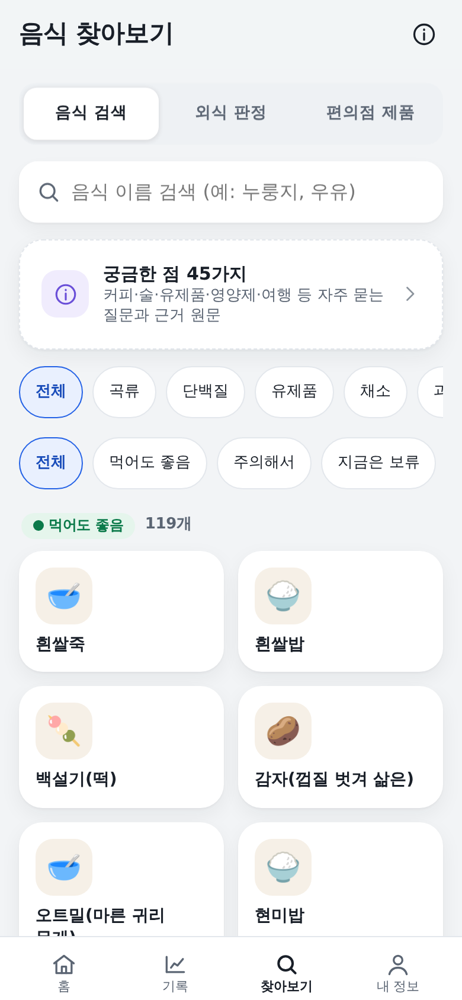
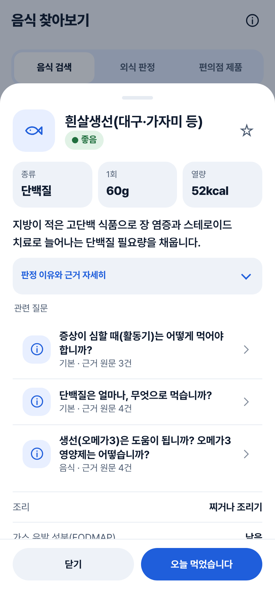
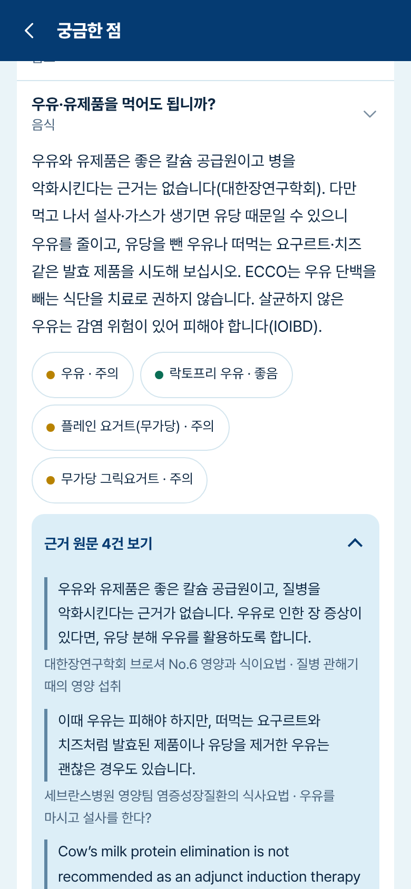
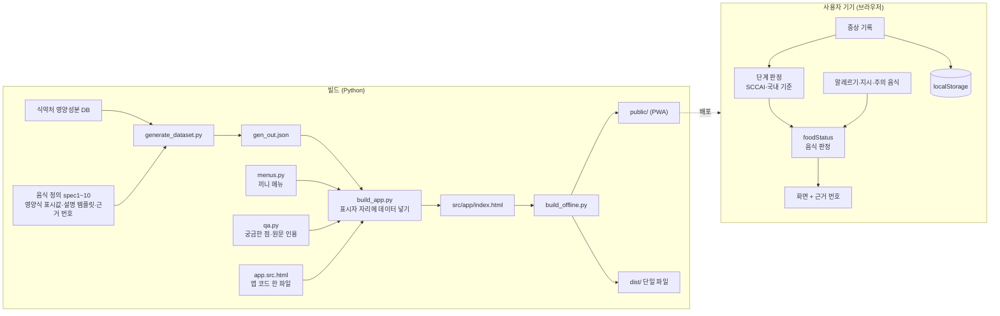

<div align="center">



# 

UC 식단 관리 도우미

**궤양성 대장염 환자가 "오늘 이거 먹어도 되나?"를 근거와 함께 바로 확인하는 모바일 웹앱**

[](https://github.com/Park11234/uc-table/actions/workflows/test.yml)


### 바로 써 보기

[**▶ 앱 열기**](https://park11234.github.io/uc-table/) &nbsp;·&nbsp; [**⬇ 오프라인 파일 받기**](https://github.com/Park11234/uc-table/releases/latest/download/uc-table-offline.html)

설치 없이 브라우저에서 열리고, 휴대폰에서는 '홈 화면에 추가'하면 인터넷 없이도 씁니다.
AI를 쓰지 않습니다. 판정·식단·검색·질문 답은 모두 앱 안의 자료와 규칙으로 기기에서 처리합니다(v1.7.0).



</div>

## 숫자로 보는 프로젝트

| 음식 판정 | 끼니 메뉴 | 궁금한 점 | 근거 자료 | 자동 점검 | 저장 데이터 손상 퍼징 | 접근성(WCAG 2.2 AA) | 외부 요청 |
|:---:|:---:|:---:|:---:|:---:|:---:|:---:|:---:|
| **1,771종** | **1,174개** | **51문항 · 원문 인용 169건** | **87건** | **Playwright 54개 + 파이썬 73개** | **1,297가지 → 오류 0** | **위반 0** | **0건**(오프라인 빌드) |

**기술 스택** — Vanilla JS(HTML 한 파일, 프레임워크 없음) · localStorage · Service Worker(PWA) · html2canvas + jsPDF · Python(음식 데이터 파이프라인) · Playwright · axe-core · ESLint · GitHub Actions / Pages

## 왜 만들었나

궤양성 대장염 환자로서 끼니마다 "이건 먹어도 되나"를 다시 찾아봐야 하는 불편을 직접 겪었습니다.
같은 음식이라도 **활동기냐 관해기냐에 따라** 먹어도 되는지가 달라지는데, 환자용 안내문은
"기름진 음식을 피하세요"에서 끝나는 경우가 많아 식탁 앞에서는 판단하기 어렵습니다.

그래서 이 판단을 세 단계로 자동화하고, 자주 묻는 질문은 원문과 함께 앱에 넣었습니다.

1. **증상 기록 → 지금의 단계**: 증상을 기록하면 SCCAI 점수와 국내 기준으로 저잔사식·이행식·지중해식 중 하나를 고릅니다.
2. **단계 → 음식별 판정**: 1,771종 각각을 좋음·주의·다음 단계·피하기로 나누고, 아질산염(발색제)을 넣은 가공육은 '절대 금지'로 둡니다. 알레르기·의료진 지시·싫어하는 음식도 함께 반영합니다.
3. **판정 → 근거**: 모든 판정 문구에 지침·논문 번호가 붙어 있어, 눌러서 출처를 확인할 수 있습니다.
4. **궁금한 점 → 원문**: 커피·술·영양제처럼 자주 묻는 질문의 답에 학회·병원·국제 지침의 원문 문장을 그대로 붙여, AI 없이도 찾아보고 출처를 대조할 수 있습니다.

| 홈(오늘 식단) | 증상 기록 | 음식 찾아보기 | 판정과 근거 | 궁금한 점(근거 원문) |
|---|---|---|---|---|
|  |  |  |  |  |

어두운 화면: [홈](docs/screenshots/home-dark.png) · [상세](docs/screenshots/detail-dark.png) · [궁금한 점](docs/screenshots/qa-dark.png)

## 기능

| 기능 | 내용 |
|---|---|
| **증상 기록** | SCCAI 6개 항목에 혈변 횟수·복통·변 모양·복약·체온·맥박(가스·피로는 선택)을 더해 질문 4쪽과 요약 1쪽(꼭 답할 질문 3개)으로 기록. 바쁠 때는 **빠른 기록**(배변 횟수·급박감·피 세 가지), 홈의 '평소와 같음' 한 번으로 최근 기록과 같게 저장. 피 섞인 변 횟수와 피의 정도가 맞지 않으면 알림. 14일 점수 추이, 위험 신호, **3일 연속 활동기 기준이면 주치의 연락을 고려하라는 안내**(예측이 아님) |
| **단계 판정** | 아래 기준표에 따라 자동 판정, 직접 고정도 가능 |
| **식단** | 끼니 메뉴 **1,174개**(아침 226 · 점심 421 · 저녁 422 · 곁들임 105) 중 단계·알레르기·지시 사항·주의 음식을 통과한 것으로 **7일 식단**(아침·점심·저녁) 구성. 체중에 맞춰 밥·단백질 반찬 양을 늘리거나 줄이고(v1.10.0부터 단백질도 양쪽으로) 나트륨·칼슘·아침 단백질을 맞춤. 끼니마다 '먹음'과 **바꾸기**(안 먹음·다른 메뉴·메뉴 고르기) 두 버튼(메뉴·재료 이름으로 찾기), **내가 만든 메뉴** 저장 |
| **음식 찾아보기** | 1,771종(뉴케어 등 영양식 39종, 시판 과자·사탕·젤리·초콜릿 83종, 시판 라면 55종, 마트·편의점 제품 17종, 판매처 고시·포장 표시에서 옮긴 시판 제품 1,039종, 흔한 외식 메뉴 41종 포함)을 이름·초성·자모로 검색. **지금 먹을 수 있는 음식(좋음·주의)을 맨 앞에**, 일반 음식을 먼저 보이고 시판 제품은 접어 둠. 결과는 한 줄 목록(종류 또는 시판·총 용량, 1회 양·열량), 종류·판정 걸러 보기는 시트 안에서. 음식 정보는 판정 이유 한 줄 + '자세히', 피하는 음식에는 **대신 이것**(지금 먹을 수 있는 비슷한 음식), 자료가 있는 영양값만, **확인 날짜**(그 음식을 앱에 넣은 날). 용량만 다른 같은 제품은 한 음식으로 묶고 다른 용량을 함께 보임 |
| **궁금한 점** | 커피·술·유제품·채소·과일·붉은 고기·영양음료·엽산·철분·칼슘·유산균·스테로이드·여행, 그리고 v1.10.0의 음식이 무서워 자꾸 줄일 때·외출 때 화장실·학교·회사 급식·가족 식사·식비·유튜브·인터넷 정보 등 51문항. 답마다 대한장연구학회·국내 병원·국제 지침(ECCO·ESPEN·AGA·IOIBD·ACG)의 **원문 문장을 글자 그대로** 위치와 함께 붙이고, 관련 음식의 지금 판정으로 바로 이동 |
| **외식·편의점 판정** | 메뉴 이름과 재료를 적으면 규칙으로 판정(앱 음식 목록에 없는 메뉴는 조리법·양념을 알 수 없어 가장 좋아도 '주의'). 순두부찌개·돼지국밥·제육덮밥·연어덮밥 같은 흔한 외식 메뉴 41종을 넣었고, '샐러드'·'국밥'처럼 종류가 많은 이름은 어떤 메뉴인지 고르게 하며 고르기 전에는 가장 엄격한 판정. 제품은 포장의 원재료명·알레르기 표시와 영양정보 표를 옮겨 적어 검사하고, **바코드**는 처음 한 번 음식과 연결해 두면 다음부터 바로 찾음(앱 자료에는 바코드 번호가 없음) |
| **홈(오늘 끼니)** | 맨 위 '오늘 할 일'(증상 기록·끼니 표시·물)을 줄마다 바로 처리하고, 증상 기록 입구는 여기 한 곳. 한 줄 요약(계획·먹은 양·단백질)을 누르면 오늘 영양 화면(모자람 강조는 저녁 7시 뒤에만). '먹음'은 반·전부·더 많이로 골라 합계에 반영 |
| **영양·목표·보고서** | 먹은 음식과 수분을 BMI에 맞춘 열량 목표(대한비만학회)·단백질 목표(ESPEN)와 비교(나트륨·비타민 D 포함, 자료 없는 음식은 합계에서 빼고 표시). 목표 직접 정하기, 다른 날 기록 가져오기, 최근 7일·30일 보고서. 의도하지 않은 체중 감소는 GLIM 기준으로 알림 |
| **먹은 음식 추가** | 끼니 칸마다 자주 먹은 음식·★ 즐겨찾기·최근 음식을 먼저. 생것·익힌 뒤·완성된 음식 무게 기준과 FODMAP 1회량(79종, 낮음·중간·높음과 주된 성분)을 함께 표시 |
| **장보기·알림** | 7일 식단을 살 때 재료로(밥·죽은 생쌀 무게, 손질 전 무게, 완성 음식은 레시피 재료), 식사·증상 기록 시간을 휴대폰 캘린더 알림 파일(.ics)로 |
| **음식 다시 먹어 보기** | 주의 음식을 3일에 걸쳐 조금씩 다시 시도하며 기록 |
| **건강 관리 점검 · 진료용 PDF** | 예방접종·검진 확인 목록, 기간별 증상·음식 평가와 '진료 때 물어볼 것'을 담은 PDF(검색·복사가 되는 글자 PDF와 그림 PDF) |
| **식사–증상 관계** | 먹은 날과 먹지 않은 날의 증상 점수를 비교해 '의심 후보'만 보여 줌(원인이라는 뜻이 아니며 의료진과 상의하도록 안내) |
| **첫 실행 설정 · 기록 보호** | 동의 뒤 3단계 설정(내 정보·알레르기·요즘 장 상태와 오늘 증상), 백업 불러오기, 그냥 시작하기. 기록이 없을 때 요즘 상태로 시작 단계를 정함. 두 창에서 열면 덮어쓰기 방지, 백업 뒤 바뀐 날 수 안내, 불러오기 전 비교표와 합치기·되돌리기, 오류 안내 화면 |
| **백업·내보내기** | 백업 파일 저장·복사·**보내기**(메일·메신저·파일 앱, 아이폰은 이 방법), 진료 PDF 보내기, 증상 기록·먹은 음식 **CSV**(엑셀). 자동 백업: 이 기기 안 보관본(최근 7일)과 PC 크롬·엣지의 **자동 백업 폴더**(기록이 바뀌면 날짜별 파일) |
| **PC·아이폰** | PC에서는 PC 전용 화면 없이 휴대폰과 같은 화면을 가운데 640px로 띄움. 아이폰은 입력칸 확대 방지(16px)·안전 영역·공유로 저장 |

### 단계 판정 기준

최근 3일 안의 가장 최근 기록으로 판정합니다. 번호는 [근거 목록](docs/evidence.md)의 번호입니다.

| 조건 | 단계 | 근거 |
|---|---|---|
| 위험 신호(혈변 하루 6회 이상, 배변 하루 15회 이상, 고열과 빠른 맥박, 심한 복통, 구토 등) | 저잔사식 + 진료 안내 | [38], [12], [40], [41] |
| SCCAI 5점 이상 | 저잔사식 | [15] |
| 혈변 하루 4회 이상 | 저잔사식 | [12] |
| 배변 하루 5회 이상이면서 혈변 | 저잔사식 | [38] |
| 배변 하루 3회 이하, 혈변·급박감 없음, 복통 4 미만, 주의 신호 없음 | 지중해식 | [38] |
| 그 밖 | 이행식 | — |

- **SCCAI**(Simple Clinical Colitis Activity Index, 간이 임상 대장염 활동도 지수)는 낮·밤 배변 횟수, 급박감, 혈변 정도, 전반적 상태, 장외 증상 6개 항목의 합입니다[11]. 5점 이상은 재발을 민감도 92%·특이도 93%로 구분하고, 환자가 직접 작성해도 의사 평가와 차이가 작다고 보고됐습니다[15].
- 기록이 3일 넘게 없어도 단계를 조용히 내리지 않고 마지막 기록의 단계를 쓰면서 홈에서 요즘 증상을 묻습니다. 2주 넘게 없으면 이행식으로 시작합니다(저잔사식까지 내리지 않음, v1.9.0). 단계를 직접 고정해도 위험 신호가 있으면 저잔사식으로 바뀝니다.
- 증상 기록이 하나도 없으면 첫 실행 때 고른 요즘 장 상태(심함·좋아지는 중·거의 없음·모름)로 시작 단계를 정합니다(모르면 저잔사식, v1.10.0). 기록하면 기록이 우선합니다.
- 빠른 기록(세 문항)은 빠진 항목을 0점으로 두고 계산해 실제 점수보다 낮을 수 있음을 화면에 밝힙니다.

## AI 기능을 뺀 이유(v1.7.0)

예전 버전은 Claude 앱 안에서 열면 AI가 식단을 짜고 사진을 읽었지만, v1.7.0에서 모두 뺐습니다.
AI 답은 매번 달라 규칙으로 다시 검사해야 했고, 그 검사를 통과해도 설명 문장까지 검증할 수는 없었기 때문입니다.
대신 그 자리를 **확인할 수 있는 자료**로 채웠습니다.

- **끼니 메뉴 1,174개**: 이미 근거를 확인한 재료와 조합 규칙(단계별 채소 수·분량, 짠 식품 상한, 같은 날 주재료 겹침 방지)으로만 만듭니다.
- **궁금한 점 45문항**: 답의 근거 문장 145건을 원문 그대로 싣고, 인용이 원문 파일에 글자 그대로 있는지 단위 점검이 확인합니다(PDF에서 공백·줄바꿈만 무시). 해외 지침 4편은 원문 페이지에서 다시 대조했습니다.
- 시판 과자·라면·마트 제품은 공식 포장 표시·식약처 DB·열량 계산이 서로 맞는 제품만 넣었고, v1.9.0에서 더한 시판 제품 1,059종은 판매처 한 곳의 포장 표시·상품정보 고시를 그대로 옮기고 출처를 밝혔습니다(사용자 요청). 외식 프랜차이즈 메뉴는 넣지 않았습니다.

예전에 AI로 만든 식단이 기기에 남아 있으면 그대로 보여 주고, 버튼 하나로 앱 규칙 식단으로 바꿀 수 있습니다.

## 기술적으로 신경 쓴 점

**판정은 규칙으로, 근거는 번호로.** 같은 입력엔 항상 같은 답이 나오도록 판정을 결정적인 코드(`foodStatus`)에 두었고, 판정마다 87건의 지침·논문·공식 발표·제품 자료 중 어디서 왔는지 번호를 붙였습니다
(ESPEN 2023, AGA 2024, IOIBD 2020, ECCO 2025, Monash FODMAP, 병원 저잔사식 안내 등). 원문을 읽지 못한 자료 2건은 인용하지 않고 문서에 그 사실을 남겼습니다.
궁금한 점의 답은 근거 문장을 원문 그대로 붙여, 누구나 출처와 위치로 찾아 대조할 수 있게 했습니다.

**데이터는 손으로 적지 않았습니다.** 기본 음식 691종의 영양값은 식약처 DB에서 이름으로 행을 찾아 붙이는 파이프라인으로 만들었고(영양식은 판매처 제품 표시값, 시판 과자·사탕·젤리·초콜릿·라면은 제조사 공식 자료와 식약처 가공식품 DB를 3중 대조, 마트 시판 식품은 여기에 이마트몰 포장 사진까지 대조, 원재료 49종과 밥·죽은 더 새로 고친 국가표준식품성분 DB 10.4),
원자료의 이상치(예: 멸치볶음 섬유 10.1 g)는 같은 음식의 다른 분석값과 대조해 코드로 고정했습니다.
v1.9.0의 시판 제품은 판매처 고시·포장 표시를 옮긴 기록을 가져오기 스크립트(`tools/cj_import.py`·`brand_import.py`·`label_import.py`)로 앱 데이터로 바꾸고, 열량 계산(4·4·9)·당류≤탄수화물·포화지방≤지방 같은 단위 점검으로 옮겨 적은 값을 확인합니다.
같은 이름의 요리 값이 여럿이면 분석값(가정식 → 외식)을 먼저 쓰고, 없으면 재료량 산출값의 평균을 씁니다(FAO/INFOODS 음식 맞추기 지침 등). 어떤 값을 골랐는지와 같은 이름 자료의 열량 범위를 음식 정보에 보여 줍니다.
스크립트를 다시 돌리면 배포본과 **바이트 단위로 같은** 파일이 나오며, CI가 이를 매번 확인합니다.

**저장 데이터를 믿지 않습니다.** 기록을 불러올 때마다 모든 항목의 형식과 범위를 확인합니다.
실제 기록을 1,297가지로 망가뜨려 모든 화면과 PDF를 그려 보는 퍼징 점검에서 처음엔 앱 멈춤 1종, 화면 오류 2종,
`NaN`·`[object Object]` 노출 여러 곳이 나왔고, 지금은 모두 0입니다.

**오프라인이 기본입니다.** 빌드가 PDF 라이브러리를 파일 안에 넣고 외부 글꼴을 지워 요청 0건으로 동작합니다.
서비스 워커 캐시 이름을 앱 내용의 해시로 정해, 앱을 고치면 설치된 기기에도 새 버전이 전달됩니다(점검으로 확인).

**실제 사용 환경을 점검합니다.** 한글 IME 조합 입력, 키보드가 올라온 좁은 화면, 320 px, 큰 글자, 다크 모드,
사용자 입력의 HTML 주입, 접근성(axe-core, WCAG 2.2 AA)을 Playwright로 확인하고 ESLint 경고 0을 유지합니다.
모든 화면의 버튼을 2단계까지 눌러 보고 검색칸마다 이상한 검색어를 넣는 누름·검색 퍼징(누름 약 2,300회)과, 주요 화면 10개를 기준 화면과 픽셀로 비교하는 화면 비교 점검도 돌립니다.
앱을 일부러 54가지 방식으로 망가뜨려(일반 햄이 다시 '피하기', 묶인 옛 제품 id를 잇지 않음, '샐러드'를 한 음식으로 판정, PC에서 전체 너비, CSV 수식 막기 빠짐, 단백질을 늘리기만 함, 나트륨·지방 규칙 삭제, 교체 메뉴를 이름으로 저장, 버튼 오류, 검색 목록 재생성, 저장 전에 바뀌는 내 정보, 다른 창의 기록 덮어쓰기, BMI 목표 빠짐, 화면 디자인이 몰래 바뀜, 뒤로 가기가 앱 밖으로 넘어감, 끝낸 할 일 줄이 다른 규칙에 걸려 깨짐 등) 해당 점검 56쌍이 실제로 실패하는지도 매주 확인합니다([점검 체계](docs/testing.md)).

**기록은 기기 밖으로 나가지 않습니다.** 서버·계정·분석 도구가 없고, 저장은 기기의 localStorage 한 곳입니다.
같은 앱을 두 창에서 열어도 서로 덮어쓰지 않게 막고, 백업을 불러올 때는 지금 기록과 비교해 합치거나 되돌릴 수 있습니다.

**근거도 낡지 않게 관리합니다.** 참고문헌마다 근거 종류와 확인 날짜를 적고, 1년이 넘은 근거와 열리지 않는 링크를 매달 자동으로 점검합니다(`tools/stale_check.py`, `tools/link_check.py`).

## 구조



자세한 설명: [구조](docs/architecture.md) · [설계 결정 16가지](docs/decisions.md)

## 만든 과정

1. **문제 정의** — 궤양성 대장염 환자로서 평소 음식을 먹을 때 불편했던 점을 바탕으로, 식탁 앞에서 바로 판단할 수 있는 도구를 기획했습니다.
2. **AI와의 역할 분담** — 설계·구현·검토에 AI 도구(Claude)를 활용했습니다. 문제와 제약은 직접 정했고(하루 세 끼 기준 식단, 검사 수치 입력 제외, '다음'을 눌러야 넘어가는 증상 기록, 기능보다 신뢰성 우선, 앱 안에서는 AI를 쓰지 않음), 판정 규칙은 진료지침·병원 식이 안내·논문의 원문을 확인해 확정했습니다.
3. **검증으로 걸러 낸 사례** — "판정을 논문과 병원 지침으로 다시 검토하라"는 요구에 따라 식약처 원자료를 대조하는 점검을 만들었고, 그 과정에서 멸치볶음 섬유 10.1 g 같은 원자료 이상치 10건을 찾아 바로잡았습니다. 신뢰성 점검에서는 저장 데이터 손상 퍼징으로 앱이 멈추는 경우를 찾아 고쳤고, 기존 테스트가 결과를 확인하지 않고 늘 통과하던 문제도 발견해 단언과 돌연변이 점검을 넣었습니다.
4. **사용 의견 반영** — 주변 지인에게 앱을 소개해 비공식적으로 사용 경험을 듣고, 나온 의견을 AI와 함께 반영했습니다.

더 자세한 사례와 검증 방법은 [AI와 함께 만든 방법](docs/ai-workflow.md)에 정리했습니다.

## 오프라인으로 쓰기

| 방법 | 쓰는 법 |
|---|---|
| [설치형 앱](https://park11234.github.io/uc-table/)(권장) | 휴대폰 크롬으로 한 번 연 뒤 메뉴 → **홈 화면에 추가**. 이후 비행기 모드에서도 열리고, 앱을 고치면 다음에 열 때 새 버전으로 바뀝니다. |
| [파일 하나로](https://github.com/Park11234/uc-table/releases/latest/download/uc-table-offline.html) | 내려받은 파일을 크롬으로 열면 인터넷 없이 동작합니다(약 3.6 MB, 외부 요청 0건). 파일로 열 때는 서비스 워커가 동작하지 않지만, 파일 자체에 모든 것이 들어 있어 필요 없습니다. |

- 기록은 연 주소(또는 파일)마다 따로 저장됩니다. 옮길 때는 **내 정보 → 데이터 백업 → 백업 파일 저장**으로 파일을 만든 뒤, 새 곳의 같은 화면에서 **백업 파일 불러오기**를 누르세요.
- 파일 링크는 main에 올릴 때마다 `release` 워크플로가 최신 파일로 바꿔 붙입니다.
- 오프라인에서도 모든 기능이 같습니다. **끼니 메뉴 1,174개**에서 그날 단계·알레르기·의료진 지시·주의 음식에 맞는 것만 골라 7일 식단을 만들고, 궁금한 점 45문항과 근거 원문도 파일 안에 들어 있습니다.

## 실행과 개발

**필요 환경**

| 용도 | 필요한 것 |
|---|---|
| 앱 빌드(`build_app.py`, `build_offline.py`) | Python 3.11 이상, 표준 라이브러리만 사용(3.11·3.12에서 재현 확인) |
| 영양 데이터 재생성(`generate_dataset.py`) | pandas, 식약처 원본 CSV |
| 로고·아이콘(`tools/brand.cjs`) | Node.js와 Playwright(글자를 선으로 직접 그려 글꼴 파일 없음) |
| 대표 이미지(`make_social_preview.py`) | Pillow, Noto Sans CJK 글꼴 |
| 점검 | Node.js 20 이상, `package.json`에 고정된 Playwright 1.56 · ESLint · axe-core |

**실행**

```bash
git clone https://github.com/Park11234/uc-table.git
cd uc-table
python3 -m http.server 8080 --directory public   # http://localhost:8080 (npm run serve와 같음, npm install 불필요)
```

- `dist/uc-table-offline.html`(빌드 결과)을 파일로 열면 인터넷 없이 동작합니다.
- `src/app/index.html`을 파일로 직접 열면 글꼴·PDF 도구를 인터넷에서 받고, 서비스 워커(오프라인 캐시)는 동작하지 않습니다.

**수정할 때**

`src/app/index.html`은 빌드 결과물이므로 직접 고치지 마세요. 다음 빌드에서 덮어써지고, CI의 재현 확인이 실패합니다.
앱 코드(화면·판정 규칙·식단)는 `src/app/app.src.html` 한 파일에서 고칩니다. 생성 데이터가 들어갈 자리는 `/*@GEN:이름@*/` 표시자로 남아 있습니다.
음식은 `src/data/spec*.py`, 영양식 제품 표시값은 `src/data/spec8.py`의 `LABEL`, 판정 문구는 `src/data/templates.py`, 끼니 메뉴는 `src/data/menus.py`, 궁금한 점은 `src/data/qa.py`에서 고친 뒤 다시 빌드합니다.
궁금한 점의 인용 대조에 쓰는 원문 파일(`data/sources/*.txt`)은 저작권 때문에 저장소에 넣지 않습니다. 파일을 만드는 법은 [근거 목록](docs/evidence.md#궁금한-점의-근거-원문-대조v170)에 있습니다.
참고문헌을 바꾸면 `python3 tools/sync_evidence.py`로 [근거 목록](docs/evidence.md) 표를 다시 만듭니다.

```bash
python3 src/data/build_app.py    # app.src.html의 표시자 자리에 데이터·메뉴를 넣어 src/app/index.html 생성
python3 tools/build_offline.py   # public/(PWA)과 dist/(단일 파일) 생성
npm ci && npx playwright install --with-deps chromium   # package-lock.json 그대로 설치
npm run lint                     # ESLint (경고 0)
npm run test:py                  # 데이터 생성 코드 단위 점검 73개(파이썬 표준 라이브러리만)
npm test                         # Playwright 점검 53개(화면 비교는 node tests/visual/visual.cjs)
npm run test:mutation            # 일부러 망가뜨린 앱 54개를 점검이 잡는지(CI는 매주 한 번)
python3 tools/stale_check.py     # 확인한 지 1년 넘은 근거
python3 tools/link_check.py      # 참고문헌·레시피 링크 형식(--online은 실제로 열어 봄)
python3 tools/tone_check.py      # 앱 문구에 해요체(~요)가 남았는지(앱 문구는 ~입니다·~합니다)
```

식약처 원본 CSV를 `data/mfds/`에 두면 영양 데이터부터 다시 만들 수 있습니다([받는 법](docs/data-sources.md)).

## 저장소 구조

```
index.html    저장소 첫 주소로 들어오면 앱(public/)으로 연결
src/app/      앱 코드 한 파일(app.src.html)과 빌드 결과(index.html)
src/brand/    UC TABLE 로고·앱 아이콘 SVG(tools/brand.cjs가 만듦)
src/data/     음식 정의(spec1~10) · 시판 제품 기록(cj10·brand10·label10) · 영양식 표시값(spec8 LABEL) · 끼니 메뉴(menus.py) · 궁금한 점(qa.py) · 설명 템플릿 · 생성·빌드 스크립트
public/       GitHub Pages로 여는 오프라인 PWA
tests/        Playwright 점검 53개 (regression 27 · checks 25 · visual 1) · 파이썬 단위 점검(tests/python) · 돌연변이 점검
tools/        오프라인 빌드 · 근거 표 동기화 · 근거 확인일·링크·말투 점검 · 로고·아이콘(brand.cjs) · 스크린샷 · 린트용 추출 스크립트
docs/         구조 · 설계 결정 · 점검 · AI 활용 · 데이터 출처 · 근거 목록 · 출시 준비(release.md)
vendor/       인라인하는 오픈소스(html2canvas, jsPDF)와 라이선스
```

## 출처

- **영양성분**: 식품의약품안전처 식품영양성분DB(공공데이터포털 공개본의 이용허락범위 '제한 없음')와 농촌진흥청 국가표준식품성분 DB 10.4(원재료 49종, 밥·죽). 앱의 음식 상세 화면마다 출처·식품명·식품코드를 표시합니다.
- **시판 과자·사탕·젤리·초콜릿**: 농심몰·롯데웰푸드 스위트몰·해태몰 포장 표시 이미지, 크라운제과·오리온 제품 소개, 식약처 가공식품 DB(2026-08-28)와 3중 대조(2026-09-29~30 확인).
- **판정 근거**: 진료지침·병원 식이 안내·논문·공식 발표·제품 자료 87건 — [근거 목록](docs/evidence.md)
- **시판 제품(v1.9.0)**: CJ더마켓 상품정보 제공고시, 동원몰 상품정보 제공고시·상품 상세 포장 표시, 식품안전나라 품목제조보고, 랭킹닭컴·아임닭·풀무원샵 상품 상세 포장 표시(2026-10-14~15 확인, 제품마다 한 곳)
- **궁금한 점**: 대한장연구학회 환자용 브로셔·치료 지침, 서울아산병원·서울대학교병원·세브란스병원·가천대 길병원 식이 안내, ECCO 2025·ESPEN 2023·AGA 2024·IOIBD 2020·ACG 2025 원문(2026-10-04 확인)
- **영양식 제품**: 판매처 상품정보 제공고시(롯데아이몰)·다나와·제조사 제품 안내에 올라온 1팩 표시값을 100 ml당으로 바꿔 씁니다(2026-09-25 확인).
- **조리법 링크**: 만개의레시피 77건, 모두의레시피 12건. 앱은 링크와 재료 요약만 담고, 조리법 원문은 각 사이트에 있습니다.

자세한 내용은 [데이터 출처 문서](docs/data-sources.md)에 있습니다.

## 한계

- 의료기기가 아니며 진단·처방을 대신하지 않습니다. [의료 관련 고지](DISCLAIMER.md)를 먼저 읽어 주세요.
- 판정은 공개 지침의 일반 권고를 옮긴 것이라 개인의 침범 범위·수술력·동반 질환을 반영하지 않습니다.
- 단계 판정표는 SCCAI와 국내 기준을 이 앱이 묶은 규칙이며, 이 조합 자체를 검증한 연구는 없습니다.
- 영양값은 대표값이라 실제 조리법·분량에 따라 달라집니다. 스테비아 토마토·제로 음료 같은 시판 제품은 대표값이 없어 제품 1종의 값을 쓰므로 제품마다 다를 수 있습니다.
- 영양식 39종 가운데 18종은 원재료명을 판매처·제조사 공개 자료에서 글자로 확인하지 못해(표시가 이미지로만 올라와 있음) '확인하지 못한 제품'으로 두고 포장 확인을 안내합니다. 영양값은 26종에 표시값을 넣었고, 나머지는 '자료 없음'으로 보입니다. 특수의료용도식품은 포장 문구대로 의료진과 상담한 뒤 쓰도록 '주의해서', 신장질환자용·경관급식 전용은 '피하기'로 둡니다.
- 스테비아·알룰로스 같은 감미료가 궤양성 대장염에 미치는 영향은 연구가 부족해, 감미료 제품은 '피하기'가 아니라 '주의해서'로 둡니다(탄산음료는 탄산 때문에 '피하기').
- 궁금한 점의 답은 자료의 안내를 옮긴 것이고, 자료끼리 다른 곳(예: 술 — 대한장연구학회는 금주, IOIBD는 적은 양을 바꾸라고 권할 근거 부족)은 두 안내를 함께 적었습니다. 개인에게 맞는 결정은 주치의와 상의해야 합니다.
- v1.9.0의 시판 제품 1,059종(v1.10.0에서 용량만 다른 같은 제품을 묶어 1,039종)은 사용자 요청에 따라 판매처 한 곳에서만 확인했습니다. 포장이 바뀌었을 수 있으니 실제 포장 표시를 함께 확인하십시오. 영양정보가 없는 가공육·육포는 원재료로만 판정하고, 영양정보를 찾지 못한 만두·볶음밥·국은 넣지 않았습니다.
- 지인의 비공식 의견만 받았고, 체계적인 사용성 평가나 임상 평가는 하지 않았습니다.
- 안드로이드 크롬 기준으로 만들었고, 아이폰은 실제 기기 대신 화면 크기·입력칸 글자 크기·공유 기능을 점검으로만 확인했습니다. iOS 사파리는 홈 화면에 추가하지 않은 사이트의 저장 데이터를 한동안 쓰지 않으면 지울 수 있으므로, iOS에서는 홈 화면에 추가하고 '백업 파일 보내기'로 자주 보관하세요.
- 음식의 '확인 날짜'는 그 음식을 앱에 넣은 날입니다(사용자 요청, 1년 지난 것을 다시 확인하라는 점검은 하지 않음). v1.0.0(2026-09-24)과 v1.1.0~v1.8.0(2026-10-13)에 넣은 음식은 저장소 기록에 남은 가장 이른 날짜라, 실제로 넣은 날보다 늦을 수 있습니다.
- 흔한 외식 메뉴 41종 가운데 연어덮밥·규동·가츠동·텐동·시저샐러드·햄 토스트 6종은 식약처 음식 DB에 같은 이름 자료가 없어 영양값 없이 판정만 합니다. 알레르기 태그는 식당마다 재료가 달라 흔히 들어가는 재료를 넉넉히 붙였습니다.
- 바코드는 앱 자료에 바코드 번호(GTIN)가 없어, 처음 읽은 바코드를 사용자가 직접 음식과 연결해야 합니다. 카메라 읽기는 BarcodeDetector가 없는 브라우저(아이폰 등)에서 바코드 라이브러리(@zxing/library)를 그때 불러옵니다.

## English summary

**UC TABLE** (UC 식단 관리 도우미, UC Diet Care Assistant) is an offline-first mobile web app that helps people with ulcerative colitis decide what they can eat *today*.
Symptom logs are scored (SCCAI plus Korean clinical criteria) to pick a diet phase (low-residue → transition → Mediterranean), and 1,771 foods (including 1,056 packaged products and 41 common restaurant dishes) are
judged by deterministic rules, each linked to one of 87 cited guidelines, papers, and product sources. Nutrition values come from the Korean MFDS food database
through a reproducible pipeline (rebuild is byte-identical, checked in CI). It is a single HTML file with no framework and stores data only in localStorage.
Since v1.7.0 the app uses no AI at runtime: 1,174 meal templates built from reviewed components and 51 Q&A entries whose 169 evidence quotes are verified verbatim against the source texts by a unit test.
v1.10.0 applies a design/developer/user review: one symptom-log entry on home, a quick 3-question log, a meal row with just 'ate' and 'change', a one-line search list with edible foods first and packaged products folded, 'instead try' suggestions, merged pack sizes, an 'added on' date per food, generic ham/sausage as 'never', 41 restaurant dishes, share/CSV export, automatic local and folder backups, barcode linking, and a centered phone-width layout on PC. v1.9.0 adds a fifth verdict, "never" (absolutely avoid), for processed meats containing sodium nitrite (183 products), 1,059 packaged products copied from one seller listing each with the source shown, a 4-page symptom log with a one-tap "same as usual" entry, a meal-symptom suspect view, a text PDF for clinic visits, and fixes from a pre-launch accessibility/design review. v1.8.0 adds a meals-first home screen, a 3-step first-run setup, multi-tab write protection, backup merge/undo, BMI-based energy targets (KSSO), GLIM weight-loss alerts, FODMAP serving thresholds for 79 foods, and a documented rule for choosing among multiple dish values (FAO/INFOODS).
Quality checks: 54 Playwright suites (including pixel-level visual regression) and 73 Python unit tests including state-corruption fuzzing (1,297 cases, 0 failures), click/search fuzzing (~2,300 taps), axe-core WCAG 2.2 AA (0 violations), Korean IME input,
PWA update delivery, 44 px touch targets, and weekly mutation checks (54 deliberately broken builds) that prove the tests fail when rules break. Built in collaboration with Claude; see [docs/ai-workflow.md](docs/ai-workflow.md).

## 라이선스

코드는 [MIT](LICENSE)입니다. 영양 데이터는 식품의약품안전처 공개 데이터를 이용했으며 출처 표시를 유지합니다.
포함된 오픈소스의 라이선스는 [데이터 출처 문서](docs/data-sources.md)에 정리했습니다.
